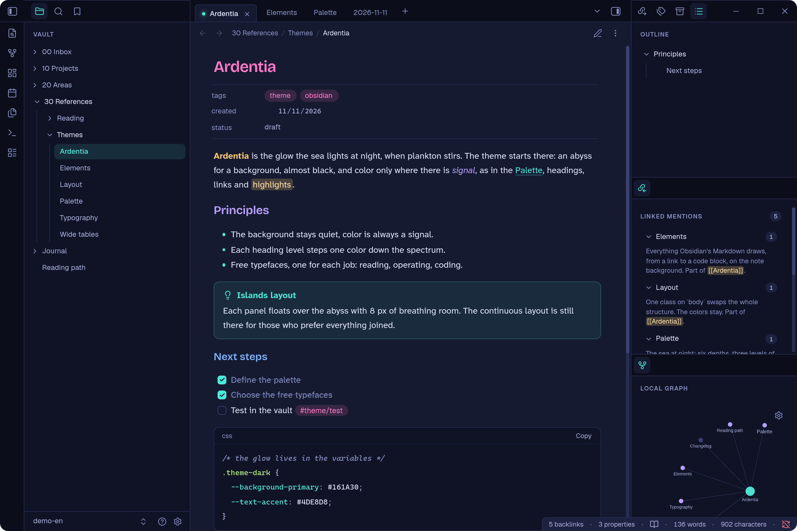
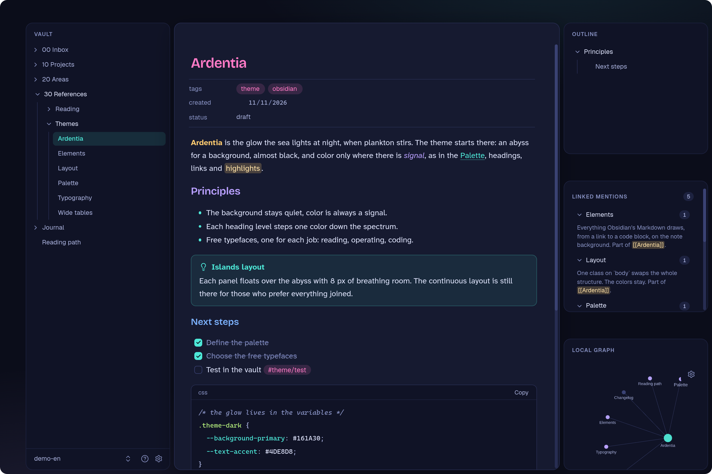
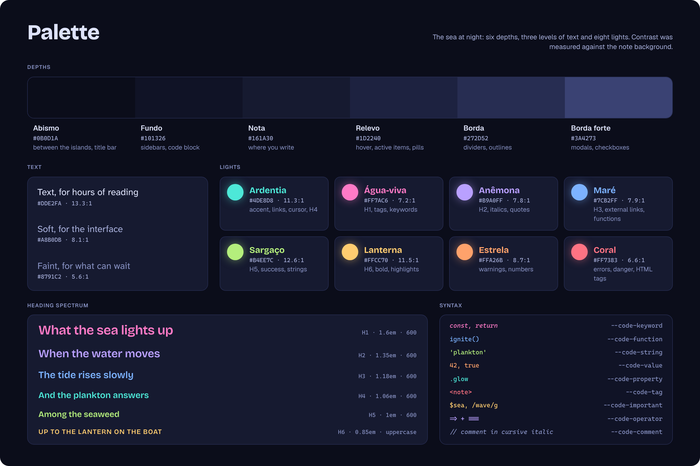

<p align="center">
  
</p>

<p align="center">
  <b>English</b> · <a href="README.pt-BR.md">Português</a>
</p>

# Ardentia

*Ardentia* is the Portuguese word for the glow the sea lights at night, when plankton stirs in dark water. The theme starts there: an abyss for a background, almost black, and color only where there is signal.

It is one palette, four typefaces and a handful of shapes, ported app by app.

| App | Status | Where |
| --- | --- | --- |
| Obsidian | Available | [`obsidian/`](obsidian/) |
| Zed | Planned | |
| VS Code | Planned | |
| Ghostty | Planned | |
| herdr | Planned | |

## Obsidian


A dark theme for Obsidian 1.6 and later. It is not a recolor: panels, tabs, the status bar, properties, callouts, code blocks, menus and the settings window were all redrawn.

- **Three layouts over the same colors.** Floating islands by default, a continuous layout for those who prefer everything joined, and a focus layout that dims the chrome until the mouse gets near.
- **A heading spectrum.** Each heading level steps one color down, from Água-viva pink at H1 to Lanterna yellow at H6.
- **One typeface per job.** Bricolage Grotesque for headings, Atkinson Hyperlegible Next for reading, Geist for the interface, Cascadia Code for code.
- **Glow on a single dial.** Every halo in the theme answers to one variable, from off to double.
- **Seven task states**, beyond done and not done.
- **Offline by design.** The theme makes no network requests.

### Install

**From Obsidian**, once the theme is listed in the community directory: Settings, Appearance, Themes, Manage, then search for Ardentia.

**By hand**, which works today:

1. Download `theme.css` and `manifest.json` from the [latest release](https://github.com/jotafurtado/ardentia/releases/latest).
2. Put both in `<your vault>/.obsidian/themes/Ardentia/`.
3. In Settings, Appearance, Themes, pick Ardentia.

**With the script**, which also copies the optional snippets:

```bash
git clone https://github.com/jotafurtado/ardentia.git
./ardentia/obsidian/install.sh "/path/to/your/vault"
```

### Layouts

One class on `body` swaps the whole structure. The colors stay.

| Layout | Class | What it does |
| --- | --- | --- |
| Ilhas (islands) | default, no class | Rounded panels floating over the abyss, pill tabs, status bar in a capsule |
| Contínuo (continuous) | `.ardentia-continuo` | Obsidian's native structure, panels joined, 1 px dividers |
| Foco (focus) | `.ardentia-foco` | Ribbon, tabs, note header and status bar fade out until the mouse comes close |

| Contínuo | Foco |
| --- | --- |
|  |  |

Obsidian has no built-in control for `body` classes. With the [Style Settings](https://github.com/mgmeyers/obsidian-style-settings) plugin installed, an Ardentia section offers the layout selector along with the glow, the gap between islands and their corner radius.

### Glow

Every halo and every haze goes through one variable, `--ardentia-brilho`: `0` turns it off, `1` is the original drawing, `2` doubles it. It drives the haze over the abyss (teal at the top right, violet at the bottom left), the halo of the active tab's light and the halo of the cursor when the editor draws its own.


To compare without a plugin, enable one of the snippets in [`obsidian/snippets/`](obsidian/snippets/): `ardentia-sem-brilho` sets it to 0, `ardentia-brilho-forte` to 2.

### Fonts

The theme calls its four families by name and downloads nothing. They reach your vault one of two ways:

- installed on the system, or
- through the `ardentia-fontes` snippet, which carries all four embedded as variable woff2 (Latin and Latin Extended, about 700 KB). Copy [`obsidian/snippets/ardentia-fontes.css`](obsidian/snippets/ardentia-fontes.css) to `<your vault>/.obsidian/snippets/` and enable it in Settings, Appearance, CSS snippets. This is the easy path for a vault synced across machines.

If a family is missing, the stack falls back to Inter, the system font and the default monospace. Whatever you choose in Settings, Appearance, Font takes priority over the theme.

### Tasks

Besides `- [ ]` and `- [x]`, the theme draws five more states:

| Syntax | State |
| --- | --- |
| `- [/]` | in progress |
| `- [>]` | deferred |
| `- [!]` | important |
| `- [?]` | question |
| `- [-]` | cancelled |

### Wide notes and tables

A theme cannot add buttons. The companion plugin [Ardentia Largura](https://github.com/jotafurtado/ardentia-width) adds two: one in the note header that stretches the whole note to the width of the pane, and one above each table that stretches only that table. It works with any theme.

### More

Variables, measurements, the demo vault and implementation notes are in [`obsidian/README.md`](obsidian/README.md).

## Palette

The sea at night: six depths, three levels of text and eight lights. Contrast ratios were measured against the note background.



<details>
<summary>Hex values, ready to copy</summary>

| Depth | Hex | Meaning | Use |
| --- | --- | --- | --- |
| Abismo | `#0B0D1A` | abyss | between the islands, title bar |
| Fundo | `#101326` | seabed | sidebars, code block |
| Nota | `#161A30` | note | where you write |
| Relevo | `#1D2240` | relief | hover, active items, pills |
| Borda | `#272D52` | border | dividers, outlines |
| Borda forte | `#3A4273` | strong border | modals, checkboxes |

| Text | Hex | Meaning | Contrast | Use |
| --- | --- | --- | --- | --- |
| Texto | `#DDE2FA` | text | 13.3:1 | hours of reading |
| Suave | `#A8B0DB` | soft | 8.1:1 | the interface |
| Tênue | `#8791C2` | faint | 5.6:1 | what can wait |

| Light | Hex | Meaning | Contrast | Use |
| --- | --- | --- | --- | --- |
| Ardentia | `#4DE8D8` | sea sparkle | 11.3:1 | accent, links, cursor, H4 |
| Água-viva | `#FF7AC6` | jellyfish | 7.2:1 | H1, tags, keywords |
| Anêmona | `#B9A0FF` | anemone | 7.8:1 | H2, italics, quotes |
| Maré | `#7CB2FF` | tide | 7.9:1 | H3, external links, functions |
| Sargaço | `#B4EE7C` | sargassum | 12.6:1 | H5, success, strings |
| Lanterna | `#FFCC70` | lantern | 11.5:1 | H6, bold, highlights |
| Estrela | `#FFA26B` | starfish | 8.7:1 | warnings, numbers |
| Coral | `#FF7383` | coral | 6.6:1 | errors, danger, HTML tags |

</details>

## Typography

Four free families, all under the SIL Open Font License and available on Google Fonts. Each one has a single job.


## Principles

- The background stays quiet. Color is always a signal.
- Each heading level steps one color down the spectrum.
- One typeface for each job: titling, reading, operating, coding.

## License

[MIT](LICENSE). The typefaces embedded in the optional font snippet keep their own license, the SIL Open Font License 1.1: see [`obsidian/snippets/FONTS.md`](obsidian/snippets/FONTS.md).
