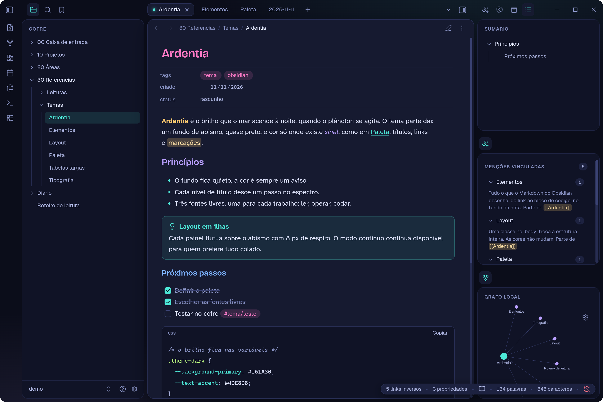
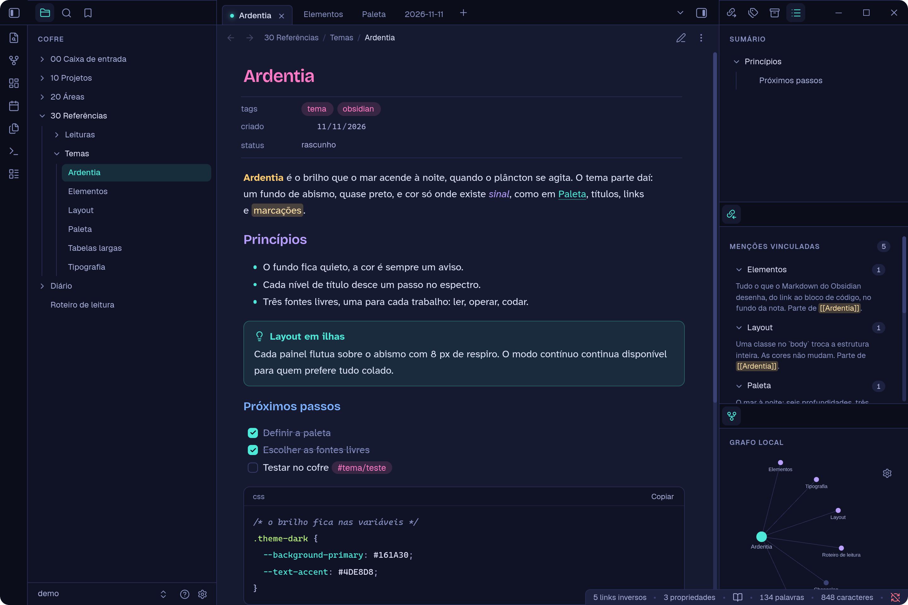
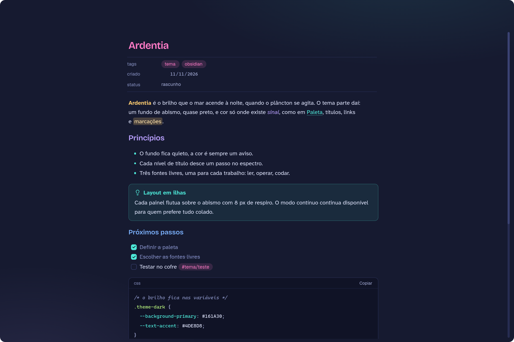
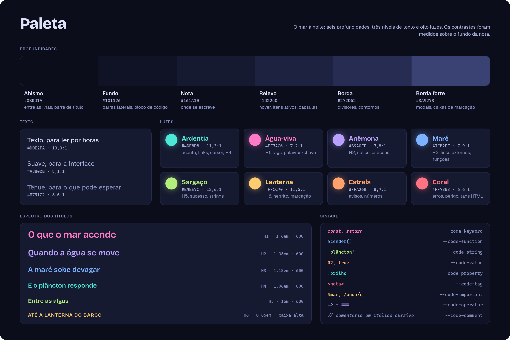
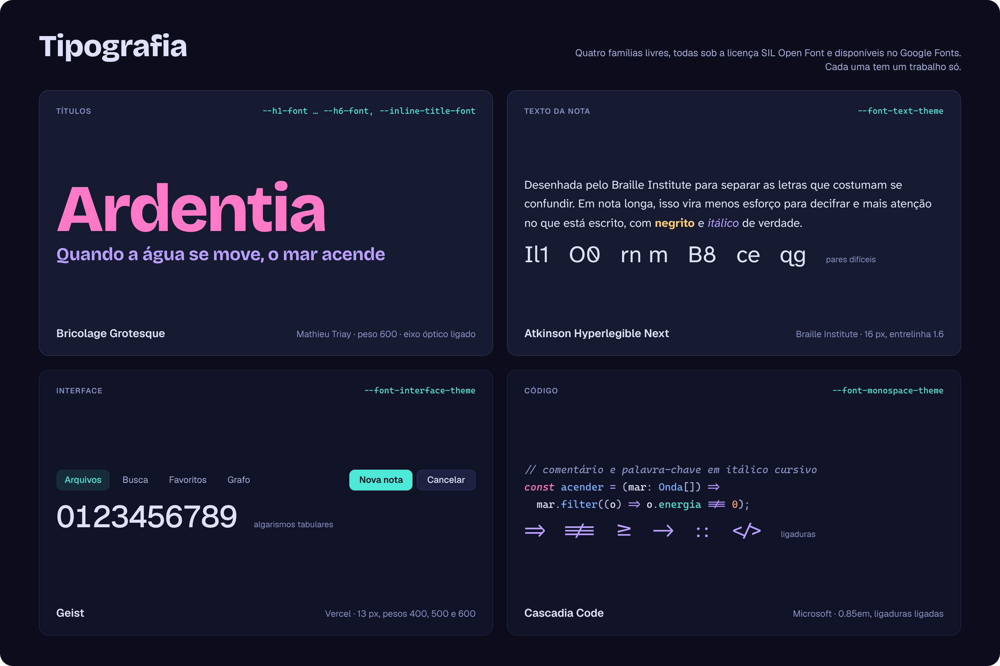

<p align="center">
  
</p>

<p align="center">
  <a href="README.md">English</a> · <b>Português</b>
</p>

# Ardentia

Ardentia é o brilho que o mar acende à noite, quando o plâncton se agita na água escura. O tema parte daí: um fundo de abismo, quase preto, e cor só onde existe sinal.

É uma paleta, quatro famílias tipográficas e um punhado de formas, levadas de aplicativo em aplicativo.

| Aplicativo | Situação | Onde |
| --- | --- | --- |
| Obsidian | Disponível | [`obsidian/`](obsidian/) |
| Zed | Disponível | [`zed/`](zed/) |
| VS Code | Disponível | [`vscode/`](vscode/) |
| Ghostty | Disponível | [`ghostty/`](ghostty/) |
| herdr | Disponível | [`herdr/`](herdr/) |
| Rex | Disponível | [`rex/`](rex/) |
| Status line do Claude Code | Disponível | [`cc-statusline/`](cc-statusline/) |

Os portes para Zed, VS Code, Ghostty, herdr, Rex e a status line do Claude Code se instalam a partir deste repositório. Nenhum deles está publicado em registro de extensões nem vem com o aplicativo ainda.

## Obsidian



Tema escuro para o Obsidian 1.6 ou mais novo. Não é uma troca de cores: painéis, abas, barra de status, propriedades, callouts, blocos de código, menus e a janela de configurações foram redesenhados.

- **Três layouts sobre as mesmas cores.** Ilhas flutuantes por padrão, um layout contínuo para quem prefere tudo colado e um layout de foco, que deixa só a nota na tela.
- **Um espectro de títulos.** Cada nível de título desce uma cor, do rosa Água-viva no H1 ao amarelo Lanterna no H6.
- **Uma fonte para cada trabalho.** Bricolage Grotesque nos títulos, Atkinson Hyperlegible Next na leitura, Geist na interface, Cascadia Code no código.
- **Brilho em um controle só.** Todo halo do tema responde a uma variável, de desligado a dobrado.
- **Sete estados de tarefa**, além de feita e não feita.
- **Feito para funcionar sem rede.** O tema não faz nenhuma requisição.

### Instalação

**Pelo Obsidian**, quando o tema estiver listado no diretório da comunidade: Configurações, Aparência, Temas, Gerenciar, e busque por Ardentia.

**À mão**, que funciona hoje:

1. Baixe `theme.css` e `manifest.json` do [release mais recente](https://github.com/jotafurtado/ardentia/releases/latest).
2. Coloque os dois em `<seu cofre>/.obsidian/themes/Ardentia/`.
3. Em Configurações, Aparência, Temas, escolha Ardentia.

**Pelo script**, que também copia os snippets opcionais:

```bash
git clone https://github.com/jotafurtado/ardentia.git
./ardentia/obsidian/install.sh "/caminho/do/cofre"
```

### Layouts

Uma classe no `body` troca a estrutura inteira. As cores não mudam.

| Layout | Classe | O que faz |
| --- | --- | --- |
| Ilhas | padrão, sem classe | Painéis arredondados sobre o abismo, abas em pílula, barra de status em cápsula |
| Contínuo | `.ardentia-continuo` | Estrutura nativa do Obsidian, painéis colados e divisores de 1 px |
| Foco | `.ardentia-foco` | Só a nota. Barras laterais e faixa de ícones saem da tela; abas, cabeçalho da nota e barra de status ficam invisíveis até o mouse chegar perto |

| Contínuo | Foco |
| --- | --- |
|  |  |

O Obsidian não tem controle nativo para classes do `body`. Com o plugin [Style Settings](https://github.com/mgmeyers/obsidian-style-settings) instalado, a seção Ardentia traz o seletor de layout, o brilho, o respiro entre as ilhas e o raio dos cantos.

### Brilho

Tudo o que é halo ou esfumaçado passa por uma variável só, `--ardentia-brilho`: `0` desliga, `1` é o desenho original, `2` dobra. Ela controla o esfumaçado do abismo (ardentia no alto à direita, anêmona embaixo à esquerda), o halo do ponto de luz da aba ativa e o halo do cursor, quando o editor desenha o próprio cursor.


Para comparar sem plugin, ative um dos snippets de [`obsidian/snippets/`](obsidian/snippets/): `ardentia-sem-brilho` deixa em 0, `ardentia-brilho-forte` em 2.

### Fontes

O tema chama as quatro famílias pelo nome e não baixa nada da rede. Elas chegam ao cofre de um destes dois jeitos:

- instaladas no sistema, ou
- pelo snippet `ardentia-fontes`, que traz as quatro embutidas em woff2 variável (latim e latim estendido, cerca de 700 KB). Copie [`obsidian/snippets/ardentia-fontes.css`](obsidian/snippets/ardentia-fontes.css) para `<seu cofre>/.obsidian/snippets/` e ative em Configurações, Aparência, Fragmentos CSS. É o caminho mais simples para cofre sincronizado entre máquinas.

Se faltar alguma família, a pilha cai para Inter, a fonte do sistema e a monoespaçada padrão. O que for escolhido em Configurações, Aparência, Fonte tem prioridade sobre o tema.

### Tarefas

Além de `- [ ]` e `- [x]`, o tema desenha mais cinco estados:

| Sintaxe | Estado |
| --- | --- |
| `- [/]` | em andamento |
| `- [>]` | adiada |
| `- [!]` | importante |
| `- [?]` | dúvida |
| `- [-]` | cancelada |

### Largura da nota e das tabelas

Tema não cria botão. O plugin [Ardentia Largura](https://github.com/jotafurtado/ardentia-width) cria dois: um no cabeçalho da nota, que estica a nota inteira até a largura do painel, e um acima de cada tabela, que estica só aquela tabela. Funciona com qualquer tema.

### Mais

Variáveis, medidas, o cofre de demonstração e as notas de implementação estão em [`obsidian/README.pt-BR.md`](obsidian/README.pt-BR.md).

## Zed

Tema escuro para o Zed, escrito contra o schema de temas v0.2.0 do Zed. O editor e o terminal ficam em Nota, os painéis em Fundo, a barra de título e a barra de status em Abismo. A sintaxe segue os blocos de código do porte do Obsidian: palavras-chave em Água-viva, funções em Maré, strings em Sargaço, comentários em Tênue.

```bash
git clone https://github.com/jotafurtado/ardentia.git
./ardentia/zed/install.sh
```

O script copia o tema para a pasta de temas locais do Zed. Escolha Ardentia no seletor de temas na próxima vez que o Zed carregar. A pasta também é uma extensão de tema do Zed, que carrega com `Install Dev Extension`.

O mapeamento de cores e as notas do porte estão em [`zed/README.pt-BR.md`](zed/README.pt-BR.md).

## VS Code

Extensão de tema de cores para o VS Code: cores do workbench, regras TextMate e realce semântico, com as mesmas superfícies e as mesmas cores de sintaxe do porte do Zed.

```bash
git clone https://github.com/jotafurtado/ardentia.git
./ardentia/vscode/install.sh
```

O script copia a extensão para `~/.vscode/extensions`. Reinicie o VS Code e escolha Ardentia com `Preferences: Color Theme`.

A instalação por `.vsix`, o mapeamento de cores e as notas do porte estão em [`vscode/README.pt-BR.md`](vscode/README.pt-BR.md).

## Ghostty

Arquivo de tema para o Ghostty que define só cores: fundo, texto, cursor, seleção, as 16 cores da paleta do terminal e as cores de divisão.

```bash
git clone https://github.com/jotafurtado/ardentia.git
./ardentia/ghostty/install.sh
```

O script copia o tema para a pasta de temas do Ghostty. Para ativar, ponha `theme = Ardentia` na sua configuração do Ghostty.

As 16 cores e as notas do porte estão em [`ghostty/README.pt-BR.md`](ghostty/README.pt-BR.md).

## herdr

Dois produtos atendem pelo nome herdr, e o porte tem um arquivo para cada um. O app desktop Herdr recebe um arquivo de tema, `ardentia.json`. O herdr de terminal não tem arquivo de tema: recebe `ardentia.toml`, um bloco para colar no `config.toml` dele.

```bash
git clone https://github.com/jotafurtado/ardentia.git
./ardentia/herdr/install.sh
```

O script copia o tema do app para a pasta de temas dele e mostra onde está o bloco do terminal. Ele não edita nenhum `config.toml`. No app, escolha `ardentia` em Settings, Look, Theme.

Os dois mapeamentos e as notas do porte estão em [`herdr/README.pt-BR.md`](herdr/README.pt-BR.md).

## Rex

O Rex importa tema no formato do Ghostty, então o porte é o mesmo arquivo de cores com instalador próprio.

```bash
git clone https://github.com/jotafurtado/ardentia.git
./ardentia/rex/install.sh
```

O script importa o tema pelo CLI do Rex, que precisa do Remote Control ligado. Com ele desligado, o script imprime os passos manuais (Settings, Themes, Import Theme). Não troca o tema ativo.

As notas estão em [`rex/README.pt-BR.md`](rex/README.pt-BR.md).

## Status line do Claude Code

Status line para o Claude Code: um script Bash que desenha a pasta, o ramo do Git, as alterações, o modelo, o contexto em uso e o nome da sessão em uma cápsula quieta. O fundo fica em Relevo e o texto leva as luzes da paleta; o contexto e as alterações trocam de cor conforme o valor. Precisa de `jq`, de `git` e de uma fonte de terminal com glifos Nerd Font.

```bash
git clone https://github.com/jotafurtado/ardentia.git
./ardentia/cc-statusline/install.sh
```

O script copia a status line para `~/.claude/ardentia-statusline.sh` e mostra a entrada `statusLine` que vai no `settings.json` do Claude Code. Ele não edita o `settings.json`.

Os segmentos, as cores de cada um e as notas do porte estão em [`cc-statusline/README.pt-BR.md`](cc-statusline/README.pt-BR.md).

## Uma paleta em todos os portes

Os portes do Zed, do VS Code, do Ghostty, do herdr e do Rex tiram as cores da paleta do tema do Obsidian, mais uma mistura já calculada para a seleção onde o formato não tem alfa. As 16 cores de terminal são as mesmas nos cinco. Um comando confere as duas regras, com o [Bun](https://bun.sh):

```bash
bun scripts/check-themes.ts
```

## Paleta

O mar à noite: seis profundidades, três níveis de texto e oito luzes. Os contrastes foram medidos sobre o fundo da nota.



<details>
<summary>Valores em hexadecimal, prontos para copiar</summary>

| Profundidade | Hex | Uso |
| --- | --- | --- |
| Abismo | `#0B0D1A` | entre as ilhas, barra de título |
| Fundo | `#101326` | barras laterais, bloco de código |
| Nota | `#161A30` | onde se escreve |
| Relevo | `#1D2240` | hover, itens ativos, cápsulas |
| Borda | `#272D52` | divisores, contornos |
| Borda forte | `#3A4273` | modais, caixas de marcação |

| Texto | Hex | Contraste | Uso |
| --- | --- | --- | --- |
| Texto | `#DDE2FA` | 13,3:1 | ler por horas |
| Suave | `#A8B0DB` | 8,1:1 | a interface |
| Tênue | `#8791C2` | 5,6:1 | o que pode esperar |

| Luz | Hex | Contraste | Uso |
| --- | --- | --- | --- |
| Ardentia | `#4DE8D8` | 11,3:1 | acento, links, cursor, H4 |
| Água-viva | `#FF7AC6` | 7,2:1 | H1, tags, palavras-chave |
| Anêmona | `#B9A0FF` | 7,8:1 | H2, itálico, citações |
| Maré | `#7CB2FF` | 7,9:1 | H3, links externos, funções |
| Sargaço | `#B4EE7C` | 12,6:1 | H5, sucesso, strings |
| Lanterna | `#FFCC70` | 11,5:1 | H6, negrito, marcação |
| Estrela | `#FFA26B` | 8,7:1 | avisos, números |
| Coral | `#FF7383` | 6,6:1 | erros, perigo, tags HTML |

</details>

## Tipografia

Quatro famílias livres, todas sob a licença SIL Open Font e disponíveis no Google Fonts. Cada uma tem um trabalho só.



## Princípios

- O fundo fica quieto. A cor é sempre um aviso.
- Cada nível de título desce um passo no espectro.
- Uma fonte para cada trabalho: titular, ler, operar, codar.

## Licença

[MIT](LICENSE). As fontes embutidas no snippet opcional mantêm a licença própria, a SIL Open Font License 1.1: veja [`obsidian/snippets/FONTS.md`](obsidian/snippets/FONTS.md).
